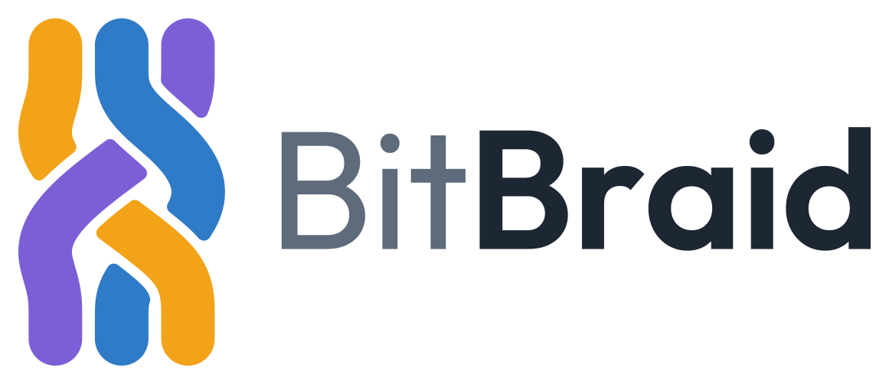
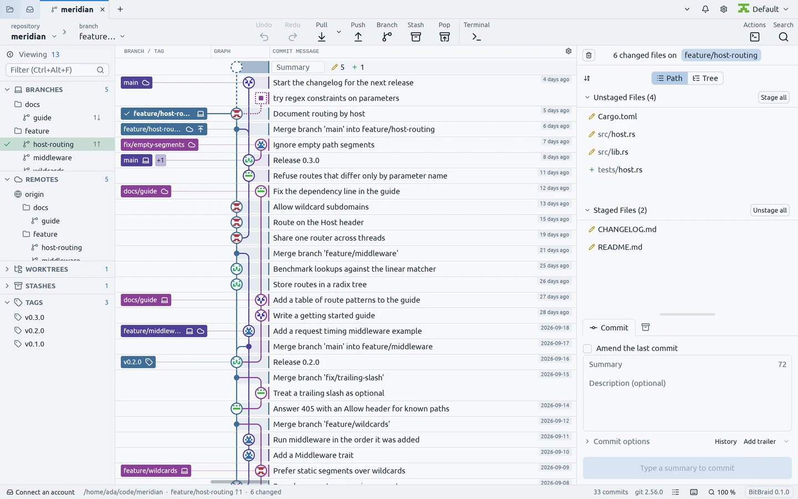

<p align="center">
  <picture>
    <source media="(prefers-color-scheme: dark)" srcset="brand/logo.svg">
    
  </picture>
</p>

# BitBraid

A native, GPU-rendered git client written in Rust, for Linux, macOS and
Windows.

<picture>
  <source media="(prefers-color-scheme: dark)" srcset="site/public/images/app-dark-1440.webp">
  
</picture>

## What it does

- A commit graph that stays smooth on a million commits; search by
  message, author, date, path or content; a file's history and blame.
- Staging down to single lines, commits and amends, and undo and redo of
  anything that changes the repository.
- Branches, tags and stashes; fetch, pull and push; merge, rebase,
  interactive rebase, cherry-pick, revert and reset; conflicts resolved
  file by file or in your merge tool.
- Worktrees, submodules, Git LFS, signing (gpg, ssh, X.509) and Gitflow.
- A terminal for each repository, inside the window.
- GitHub and GitLab, self-hosted too: cloning, creating and forking
  repositories, pull requests (create, review, merge, check out, stacks),
  issues and checks.
- Workspaces of many repositories, and one inbox for the pull requests
  and issues of all your accounts.
- Eight themes, and themes and key bindings of your own.

## Installing

From the [release page](https://github.com/BitBraid/bitbraid/releases):

| System | File | How |
|---|---|---|
| Linux | `bitbraid-<version>-x86_64.AppImage` | `chmod +x` it and start it. |
| Debian 12, Ubuntu 22.04 and later | `bitbraid_<version>_amd64.deb` | `sudo apt install ./bitbraid_<version>_amd64.deb` |
| Fedora | `bitbraid-<version>-1.x86_64.rpm` | `sudo dnf install ./bitbraid-<version>-1.x86_64.rpm` |
| Linux, unpacked | `bitbraid-<version>-x86_64-linux.tar.gz` | `tar -xzf <file> -C ~/.local --strip-components=1` |
| macOS 11 or later | `bitbraid-<version>-universal.dmg` | Drag BitBraid into Applications. |
| Windows 10 or later | `bitbraid-<version>-x86_64.msi` | Run it, or unpack `bitbraid-<version>-x86_64-windows.zip` and start `bitbraid.exe`. |

The macOS and Windows builds are not code-signed, so each system asks
once before the first start:

- **macOS**: allow it in System Settings, Privacy & Security, "Open
  Anyway", or run `xattr -dr com.apple.quarantine /Applications/BitBraid.app`.
- **Windows**: at "Windows protected your PC" choose "More info", then
  "Run anyway". Unblock the zip (its Properties, "Unblock") before
  unpacking it.

To check a download, `SHA256SUMS` lists every file's checksum
(`sha256sum --ignore-missing -c SHA256SUMS`), and each file has a
minisign signature beside it:

```
minisign -Vm <file> -p packaging/update-key.pub
```

## Privacy

No telemetry, usage statistics or crash reports. With no account
connected, BitBraid makes no network connection until you ask for
something from a remote.

- Update checks, author pictures (from Gravatar or the provider) and
  automatic fetch are off until you turn them on.
- A connected GitHub or GitLab account is asked for what the inbox, pull
  requests, issues and checks show; the inbox refreshes every 5 minutes.
- git reaches your remotes as it does in your shell, with your credential
  helpers and proxies.
- Tokens are kept only in the system's keychain.
- It listens on no port another machine can reach.

## Building

Needs Rust 1.99 or later and git 2.38 or later, and:

- **Linux**: the development packages of xkbcommon, Wayland, X11 and xcb,
  Vulkan, fontconfig, freetype, OpenSSL, zstd and zlib
  (`.github/workflows/ci.yml` installs them on Ubuntu).
- **macOS**: Xcode and its Metal toolchain
  (`xcodebuild -downloadComponent MetalToolchain`).
- **Windows**: Git for Windows and the Microsoft C++ Build Tools with the
  Windows SDK.

```
cargo run -p bitbraid -- <repository>    # start it
cargo build --profile dist -p bitbraid   # the optimised binary, in target/dist
cargo xtask ci                           # the full gate
cargo xtask                              # packages and the other tools
```

## Issues and forks

Bugs and feature requests go in the issues; pull requests are not
accepted. Forks are welcome under the licence below.

## Licence

MIT (`LICENSE`), which does not cover the BitBraid name and logo: their
terms are at the end of `LICENSE`. Git and the Git logo are trademarks of
Software Freedom Conservancy, Inc.; this project is not affiliated with
or endorsed by the Git Project.
